# Agentic Engineering: Harnesses and Workflows for Teams

Oct 22, 2026 · @Christoffer Maintz

## Summary

A coding harness is everything around an AI coding agent that makes its output trustworthy: the instructions it reads, the tools it may call, the checks that judge its work, and the loop that feeds failures back to it. The model is the engine; the harness is the steering, brakes and dashboard.

My setup has three parts that share one rule set:

- **Foundry** - a shared quality gate. Every repo, whatever its language, exposes the same six commands (`fix`, `lint`, `typecheck`, `test`, `audit`, `gate`), and the exact same checks run while the agent edits, before I push, and on the pull request.
- **cmaintz-skills** - the agent half: skills (repeatable procedures like "take this ticket to a PR") and hooks (automatic checks that fire inside the agent's session).
- **Standing context and memory** - short instruction files and a memory store that tell any agent how this team works, so nobody has to repeat it in every prompt.

The central belief: **the model proposes, deterministic checks decide.** "Done" is a green gate, never the agent saying it is done. Everything else in this write-up follows from that.

## Core beliefs

The system is built on eight beliefs. Each one exists because its opposite cost me a red build, a wasted afternoon, or a PR nobody could trust.

1. **Deterministic is the oracle; the model only proposes.** Linters, type checkers, tests and scanners decide pass or fail. A model's output is a patch, accepted only if the gate then passes from a clean tree. A model saying "I fixed it" is not evidence; the exit code is.
2. **One rule set, three placements.** The same checks run in the agent's loop, before push, and in CI. Different rules in each place gives "passes locally, fails in CI", plus an agent-specific failure: it fixes what the hook flagged, CI flags something else, it fixes that and breaks the first thing.
3. **A habit you have to remember is not a habit.** Prose in an instruction file is advisory and fades as the agent's context fills up. A hook or a CI check is enforcement. So every rule is placed in the strongest mechanism that can carry it.
4. **Ratchet, don't wall.** Turn strict linters on in a real codebase and everything is red on day one; the team abandons it by week two. Instead, record today's problems as an accepted baseline that may only shrink. New code meets the bar; old debt can't grow.
5. **Agents game metrics, so the metric must be guarded.** The cheapest fix for "this function is too complex" is a comment that switches the check off. Any PR that weakens a rule, suppresses a warning or deletes a test is blocked unless a human labels it and writes why.
6. **A reviewer must not share the author's context.** An agent reviewing its own work reviews its intent, not its diff. Reviews run in a fresh sub-agent that sees only the diff, the ticket and the repo's written rules.
7. **Reviewers advise; they never block.** The moment a model can block a merge, people argue with it instead of shipping. Blocking is reserved for deterministic checks.
8. **Prefer scripts over agents for mechanical work.** Fetching, sorting and transforming data is a script's job: cheaper, repeatable and auditable. Agents are reserved for judgement: design, review, diagnosis.

## The agent harness

The agent side has three layers, and the main design decision is which layer a rule goes in. Picking the wrong one is why most "AI coding standards" documents get ignored.

| Layer            | Mechanism                         | Character                                     | Example                                                      |
| ---------------- | --------------------------------- | --------------------------------------------- | ------------------------------------------------------------ |
| Reflex           | hooks                             | fires on its own, can block                   | "this function takes 7 parameters" before the agent may stop |
| Practice         | skills                            | invoked on demand, procedural, uses judgement | `ship`, `tdd`, `diagnosing-bugs`                             |
| Standing context | `AGENTS.md`, `CONTEXT.md`, memory | always loaded, shared vocabulary              | the domain model, team conventions                           |

### Standing context: short, specific, enforceable

`AGENTS.md` is the canonical instruction file in each repo and `CLAUDE.md` is a one-line include of it, so Claude, Codex, Gemini and Cursor all read the same source. A global file holds my personal conventions across every project. They are written as rules with reasons, not aspirations. Examples from mine:

- **Tests:** a test earns its place by going red on a realistic bug. Write it first and watch it fail; a test that has never failed has not proved anything.
- **Comments:** say why, not what. History goes in the commit message, never the code.
- **Commits and PRs:** one logical change each, small and single-purpose, written like a human engineer. No AI attribution lines.
- **Working with me:** a question is a question. "Would X be better?" gets an answer, not an action.

### Hooks: the rules an agent cannot forget

Hooks are small scripts the agent runtime fires at fixed moments. Placement follows cost: cheap checks run after every edit, slow ones once per turn.

| Hook                        | Fires                                                                       | What it does                                                                               | Blocks?          |
| --------------------------- | --------------------------------------------------------------------------- | ------------------------------------------------------------------------------------------ | ---------------- |
| `auto-format`               | after every file edit                                                       | formats just that file (sub-second), so CI never fails on whitespace                       | no               |
| `habit-hooks-guard`         | when the agent tries to finish                                              | runs the repo's pinned structural-smell sensor on the changeset and coaches the agent      | yes, until fixed |
| `typecheck-stop`            | once per turn                                                               | runs the type checker if source changed                                                    | yes              |
| `guard-generated-files`     | before an edit or shell command                                             | stops the agent hand-editing debt baselines                                                | yes              |
| `guard-pr-create`           | before a shell command                                                      | blocks a bare `gh pr create`, so every PR goes through `ship`                              | yes              |
| `pre-push` (git)            | before `git push`                                                           | runs the full gate, so humans get the same check as agents                                 | yes              |
| Jev tool-call triage, Leash | end of turn (Leash also snapshots at session start and each prompt), opt-in | a cheap model flags destructive actions or broken un-lintable rules                        | never, warn only |
| `format-java-stop`          | once per turn                                                               | runs Spotless on Java files the turn touched (a JVM formatter is too slow to run per edit) | no               |
| `pre-commit` (git)          | before git commit                                                           | formats staged files with the repo's Prettier and re-stages them                           | no               |

### Skills: procedures with judgement

Skills are reusable playbooks the agent loads when the task matches. My own set covers the delivery loop (`spec`, `feature`, `ship`, `review`, `pr-ci-watch`, `loop-report`, `repo-align`, `foundry-secret`, `codemap`). The broad practice layer comes from others, installed as plugins rather than copied so fixes flow in: Matt Pocock's skills (`tdd`, `diagnosing-bugs`, `codebase-design`, `domain-modeling`) and Ivett Ördög's (`learn`, `hotspot-rec`, `build-project-review`).

### Codemap: a verified picture of the codebase

Without it, every session starts by re-reading the repo and guessing. The `codemap` skill writes a committed map instead, under `docs/codemap/`: an `INDEX.md`, one file per domain slice, and three lens files for the data model, integrations, and runtime and deploy. A deterministic census script lists manifests, entry points, schemas, env vars, churn and files that change together, and proposes slices from the directory layout and co-change. I confirm or edit the slice plan before any agent starts. Then one fresh agent per slice, plus one per lens, traces the main flows from entry point to persistence to side effects. Every claim must cite a file or `file#Symbol`, and anything it can't confirm becomes a question under "Unknowns". A verifier checks that every citation resolves and spot-checks at least five claims per file. Nothing is written until it passes, and a refuted claim is fixed or turned into a question. Each file is stamped with the commit it was checked against, and `codemap refresh` re-audits only the slices whose cited files changed since that stamp. On the Foundry side, `mise run codemap:check` confirms every citation in the map still resolves and prints how many commits each slice has fallen behind. It is advisory and deliberately kept out of the gate, so a drifting map warns rather than blocks. The map describes and never judges: smells and risks belong to `repo-align` and `hotspot-rec`. It lands as its own docs PR through `ship`.

The delivery skills read it. `spec` draws pointers from slice citations, edge-case questions from the traced side effects, and the scope-out from neighbouring slices. `feature` reads the slices its pointers touch before coding, and warns when a slice's cited files changed since its stamp, so the code wins over a stale map. `review` asks a question whenever a diff reaches into a slice the ticket never mentioned. In a repo without a codemap, all three skip this step.

### Memory and the `learn` flywheel

At the end of a session, the `learn` skill reflects on what went wrong or right and routes each lesson to the strongest place that can hold it, in this order:

1. a deterministic hook or check, so the mistake becomes impossible
2. `AGENTS.md` / `CLAUDE.md`, so it becomes standing context
3. a new skill, so it becomes a procedure
4. auto-memory, as a last resort

That ordering is the whole thesis in one list: prefer the placement that makes a mistake impossible over the one that reminds you not to make it. My memory store holds about 25 short facts, one per file, such as "local main is often stale, fetch before branching" or "a gate change must be run before it ships, because a broken gate fails green".

## Foundry: the shared gate

Foundry is a set of reusable CI workflows, task templates and config presets that every repo inherits, so one quality bar applies across TypeScript, Java, PHP, .NET, Python and Kotlin. It answers one question for humans and agents alike: when is a change done?

### Six verbs, one interface

```
mise run fix        # auto-fix what is mechanically fixable
mise run lint       # style + structural smells
mise run typecheck  # static types
mise run test       # tests + coverage floor
mise run audit      # vulnerabilities, secrets, static security analysis
mise run gate       # all of the above, in order. The oracle.
```

Everything else (CI, git hooks, skills) calls verbs, never tools. A skill says `mise run lint`, never `eslint` or `phpstan`. That one indirection is why a single skill library serves a React repo and a Java repo. `mise` also pins every tool version, so a laptop and the CI runner can't disagree.

### Same rules, three placements

| Placement | When                           | Feedback goes to     | What runs                                   |
| --------- | ------------------------------ | -------------------- | ------------------------------------------- |
| In-loop   | while the agent edits          | the agent, mid-task  | formatter, type check, smell sensor (hooks) |
| Pre-push  | before code leaves the machine | the developer        | the full `mise run gate`                    |
| CI        | every pull request             | the permanent record | the same gate, plus security guards         |

CI is deliberately 100% deterministic: no model and no API key. Agent work runs locally, inside a session that is already paid for, before the PR exists. That also removes the riskiest combination in CI security: a model holding a key and write access on a branch an agent wrote.

The rule is itself a test. A boundary test fails the build if any gate workflow or verb calls the advisory model layer, so a model can never end up deciding pass or fail. The gate may run that layer's own unit tests, but never call it for a verdict.

### Ratchets: debt can shrink, never grow

Existing violations are recorded in committed baseline files (ESLint's built-in suppressions, the habit-hooks snooze list). Coverage floors are set to today's real number and may only rise. Fixing an old problem removes it from the baseline for good, and an automated job opens a PR whenever the baseline shrinks. A floor you can't meet is a floor you'll delete, so the bar starts where the code actually is.

### Structural smells with coaching

[habit-hooks](https://github.com/habit-hooks/habit-hooks) wraps per-language detectors and maps them onto language-independent smells: oversized file, oversized function, too many parameters, high complexity, deep nesting, duplication, dead code. When it fails it coaches the agent, and the coaching argues against mechanical compliance: splitting a file at line 200 into `foo-1.ts` and `foo-2.ts` satisfies the threshold while leaving the real problem in place. I built and published the .NET sensor for it myself.

### `ruleset-guard`: the anti-gaming control

A ratchet only sees what the tool reports, so the cheapest way to beat it is to switch the tool off. `ruleset-guard` runs on every PR and blocks, unless a human adds a label and writes the reason in the PR body:

- a change to a rule config, threshold or workflow in the same PR as source code
- a new in-source suppression (`eslint-disable`, `@ts-ignore`, `@SuppressWarnings`, `# noqa`)
- a config demotion (`"strict": false`, a severity set to none)
- a deleted or skipped test
- a debt baseline that grew

It is tightening-aware: making the gate stricter never needs a label, only loosening does.

### The rest of the CI estate

- **Security facade:** secret scanning over full history (gitleaks), the guard above, and diff-aware static analysis (Semgrep) that only flags new findings.
- **Supply chain:** every action and tool pinned by version or commit SHA; Renovate opens the update PRs.
- **Speed:** superseded runs cancel themselves, and a monorepo classifier rebuilds only the packages a PR touched. One always-running aggregate check (`gate-ok`) is what branch protection requires, so skipped jobs never wedge a merge.
- **Autofix on a label:** adding the `autofix` label to a red PR makes CI run `mise run fix`, commit the result to the branch and drop the label. It runs only on same-repo PRs, never on forks.
- **Releases:** one script cuts a semver tag from conventional commits and refuses a non-major bump if it sees a breaking change. Consumers pin `@v2` and ride non-breaking updates.
- **Backport discipline:** anything non-language-specific built in a consumer repo comes back to Foundry the same session, so every repo benefits.
- **Dogfooding:** the harness repos use their own gate. Each has a root `mise.toml` with the six verbs, the same `mise run gate` runs locally and in CI (`gate.yml` in cmaintz-skills, `self-gate.yml` in Foundry), and branch protection requires it before anything merges. So my own tickets go through `feature` and `ship` like anyone else's.

## The agent loop

A change travels from idea to `main` along one path, and the deterministic gate is the only step that can say "done". Everything an agent does is a proposal until the gate and a human agree.

```mermaid
flowchart LR
    spec["Spec<br/>ticket with criteria,<br/>DoD; owner approves"] --> claim["Claim ticket<br/>agent:working, own<br/>worktree off main"]
    claim --> impl["Implement<br/>smallest change that<br/>fixes the cause"]
    impl --> gate{"Gate green?"}
    gate -- "no: fix and re-run, max 5 rounds" --> impl
    gate -- yes --> verify["Verify<br/>green is not correct:<br/>check criteria + DoD"]
    verify --> ship["Ship<br/>fix, smells, gate,<br/>fresh-context review"]
    ship --> pr["Pull request + CI<br/>same gate, guards,<br/>no model, no keys"]
    pr --> human["Human review<br/>approve and merge;<br/>AI review advises"]
    human --> learn["Learn: a repeated mistake becomes<br/>a hook or gate check for the next loop"]
```



The loop is bounded: if two rounds make no progress, the agent stops, posts its stuck state on the ticket and flips it to `agent:blocked` for a human. There is exactly one sanctioned way to open a PR (`ship`). A hook blocks a bare `gh pr create`, which closes the common shortcut, and branch protection is the hard stop: no PR merges without the CI gate. So no change reaches review without passing the gate and a fresh-context review first. `ship` opens the PR through one script that pushes, opens it as a draft, watches CI in the background and marks it ready once green. On red, the agent fixes the cause and re-runs the same script, which pushes the new commit and watches the existing PR again, without anyone asking.

## Prompting and working practices

The biggest prompting lever is not phrasing; it is giving the agent a target it can check itself against. A prompt with a runnable definition of done beats a clever prompt every time.

### Prompting

- **Give a verifiable target.** "Make `mise run gate` green and satisfy these three acceptance criteria" converges. "Clean this up" wanders.
- **Spec before code.** The `spec` skill turns a rough idea into a ticket through a short back-and-forth: intent, an acceptance-criteria checklist, scope boundaries and pointers to the relevant code (each checked to exist in the tree), plus a Definition of Done (below). Product owners can write these; agents can claim them.
- **Done means more than behaviour.** Every ticket carries a Definition of Done next to its acceptance criteria: the non-behavioural conditions this ticket needs and the pipeline doesn't already check, such as a migration with a working down step or updated docs. Anything the gate or `ship` already enforces stays out. If the criteria already say it all, the DoD is the single line "None beyond the acceptance criteria." A ticket without one can't be claimed. `spec` drafts it with you, `feature` checks every item, and `review` holds the diff to it.
- **Separate questions from instructions.** "Would X be better?" should get an answer, not a code change. Stating this explicitly in standing context removes a whole class of surprise edits.
- **Brief sub-agents like a new colleague.** A sub-agent knows only its prompt: state the goal, what is already ruled out, which files to read, and the narrow scope. If you can't write the brief, you don't understand the task yet.
- **Ask for the finding, not the hypothesis.** Hand an agent your theory and it tends to confirm it. For verification, ask a fresh agent to refute the claim.
- **Put rules in the strongest layer.** If you find yourself repeating an instruction in prompts, it belongs in `AGENTS.md`. If it keeps being ignored there, it belongs in a hook.
- **Write for agents tersely.** Instruction files work best short and specific: rules with a one-line reason, examples of the boundary, no motivational prose. Long files dilute the rules that matter.

### Acceptance tests as the contract

The practice I lean on hardest follows Dave Farley's case for acceptance-test-driven development with AI. Natural language is too loose to specify software on its own, and vague prompts produce vague software. So the acceptance criteria stop being prose and become executable.

- **Contracts beat vibe coding.** Each acceptance criterion is written as a Given-When-Then scenario and backed by a test that proves it. It is the contract the agent works to, and a fitness function in the evolutionary-architecture sense: the change either passes it or it doesn't.
- **Executables as prompts.** Scenarios written in a small domain-specific language for the product are the most precise prompt there is. "Given a customer with an expired card, when they renew, then they are sent to update their payment details" leaves the agent nothing to guess.
- **Behaviour over boilerplate.** Nobody reads compiler output any more; we check that the program behaves. Review shifts the same way: people read the specifications and the design, and the pipeline proves the generated code meets them, instead of humans auditing every line.
- **Autonomy earned one passing spec at a time.** An agent can loop against the acceptance suite on its own, and trust grows with each scenario it turns green. The guardrails make that safe: the gate, the ratchets and `ruleset-guard` stop it passing by drifting, weakening tests or piling up debt.

In my loop, `spec` pushes every acceptance criterion towards something observable with the product owner: an input, an action, an expected result, machine-checkable where possible. Given-When-Then is the shape I write them in. `feature` implements against that checklist, loops the gate to green, then walks every criterion and every Definition of Done item and reports each as pass or fail. The fresh-context review checks the diff against the same list. Writing the failing test first is a standing rule and the `tdd` skill's job, so each criterion becomes executable through the test that proves it.

### What a ticket looks like

Every ticket is a GitHub issue with five required fields, defined by Foundry's ticket schema and enforced by an issue form:

| Field               | What it holds                                                      | Why it matters                                                    |
| ------------------- | ------------------------------------------------------------------ | ----------------------------------------------------------------- |
| Intent              | the what and why, in a sentence or two                             | the fresh-context reviewer checks the diff against it             |
| Acceptance criteria | a checklist; every item verifiable, ideally executable             | the load-bearing field: no checklist, no claim                    |
| Definition of Done  | non-behavioural done-conditions the pipeline doesn't already check | catches the migration without a down step, the doc nobody updated |
| Scope boundaries    | explicit "do not touch X"                                          | guards against silent scope creep                                 |
| Pointers            | files, modules or prior art to start from                          | saves the agent from guessing where to look                       |

Labels move it through a small state machine: `agent:ready` (only after the owner approves the whole ticket), `agent:working` (one per worker at a time) and `agent:blocked` (escalated, with the reason posted on the issue). An example:

```markdown
## Intent

As a customer whose card has expired, I want to be sent to update my
payment details when I renew, so my subscription doesn't lapse silently.

## Acceptance criteria

- [ ] Given a customer with an expired card, when they click Renew,
      then they are sent to the update-payment page and nothing is charged.
- [ ] Given a customer with a valid card, when they click Renew,
      then the renewal is charged and confirmed as it is today.
- [ ] Given the payment provider is down, when a customer renews,
      then they see a retry message and no charge is made.

## Definition of Done

- [ ] Support has approved the wording of the expired-card message.
- [ ] The runbook entry for failed renewals is updated.

## Scope boundaries

- Do not change the pricing or plan-selection screens.
- Do not touch the payment provider client beyond reading card expiry.

## Pointers

- app/Http/Controllers/RenewalController.php
- app/Services/Billing/ (the existing charge flow)
- codemap slice: billing
```

### Working discipline for a team

- **One agent, one worktree, one branch, one PR.** Parallel sessions on one checkout interleave commits and poison both PRs. Every code-editing agent gets its own git worktree off fresh `main`.
- **Bounded loops.** The feature driver retries the gate at most 5 times and bails after two rounds without progress, posting the stuck state to the ticket. An agent that can loop forever will.
- **Green is not correct.** After the gate passes, the agent checks the result against the ticket's acceptance criteria and Definition of Done, then a fresh-context reviewer checks it again.
- **Stop and surface, don't weaken.** If the only path to green is disabling a check, the agent stops and reports. That decision belongs to a human.
- **Delegate reading, keep deciding.** The main thread orchestrates; sub-agents do the wide reading and return conclusions, not file dumps.
- **Small PRs, human-style writing.** Refactors apart from behaviour changes. Commit messages and PR descriptions short and plain, so reviewers actually read them.
- **Scale verification to risk.** A typo fix gets the gate and a PR. A change to the gate itself gets run end-to-end before it ships, because a broken gate fails silently green.

## Data and feedback

The system measures itself with deterministic, local data, so that improving the harness is driven by evidence rather than by how a session felt. No dashboard costs CI minutes; the data sits next to the code.

| Signal                | Where it comes from                                                                      | What it tells you                                                                                                                      |
| --------------------- | ---------------------------------------------------------------------------------------- | -------------------------------------------------------------------------------------------------------------------------------------- |
| Loop telemetry        | every verb appends one line (verb, scope, placement, exit code, duration) to a local log | how many gate rounds a change took, which verb eats the time, and **thrash**: a check that passed, then failed again after a later fix |
| Debt baselines        | committed suppression and snooze files                                                   | whether debt is actually shrinking; a CI comment shows how each baseline moved in the PR                                               |
| Flaky-test quarantine | a baseline of known flaky tests, plus a rerun classifier                                 | flake vs real failure; a quarantined test leaves the list after enough consecutive greens                                              |
| Prompt-output evals   | scored fixtures of good and weak AI outputs                                              | whether a prompt change made output quality worse, asserted on the ranking of good above weak                                          |
| Architecture fitness  | dependency rules (dependency-cruiser, ArchUnit, import-linter) with frozen baselines     | whether layering and dependency direction still hold                                                                                   |
| Git history           | hotspot and change-coupling analysis                                                     | where maintenance cost really lives, so refactoring targets the files that change most                                                 |

Two principles govern this data. First, telemetry never changes an outcome: if logging fails, the verb's own exit code still wins. Second, evals ratchet like any other baseline: adding a fixture is free, removing one counts as loosening the gate and needs a human label.

The feedback reaches the system through `learn` (lessons become hooks or rules), `loop-report` (a short verdict: converging or thrashing, what's slow, the next action), and `hotspot-rec` (one design improvement grounded in git history). Telemetry is written by `foundry-verb-wrap` on every verb, and the flaky classifier is `foundry-flaky`, which reruns failures and re-arms a quarantined test after 10 consecutive greens.

## What the industry recommends

The field has converged on the same conclusion during 2026: model quality is no longer the bottleneck; the environment around the model is. "Harness engineering" became the name for that work in February 2026.

### The evidence that a harness matters

- **AI amplifies what is already there.** Google's [DORA 2025 report](https://dora.dev/dora-report-2025/) (about 5,000 respondents) found roughly 90% of tech professionals use AI, and that AI now correlates with higher delivery throughput, but delivery instability keeps rising too. Its core finding: AI magnifies an organisation's existing strengths and weaknesses ([InfoQ summary](https://www.infoq.com/news/2025/09/dora-state-of-ai-in-dev-2025)).
- **Feeling faster is not being faster.** In [METR's 2025 controlled trial](https://metr.org/blog/2025-07-10-early-2025-ai-experienced-os-dev-study/), 16 experienced developers on their own large codebases were 19% slower with AI, while believing they were 20% faster. The tools have improved since, but the lesson stands: measure, don't trust the feeling.
- **Trust is low.** Only 3% of developers report high trust in AI output (Stack Overflow 2025, cited by InfoQ). Deterministic gates are how a team earns trust it can't get from the model alone.

### The main frameworks

- **OpenAI: harness engineering.** A small team shipped a beta of about a million lines of code in five months with no hand-written source. Engineers designed environments and gave structured feedback; docs became the system of record; architecture layers were enforced by linters and structural tests; recurring "garbage collection" agents cleaned up drift ([InfoQ](https://www.infoq.com/news/2026/02/openai-harness-engineering-codex)).
- **Thoughtworks / Martin Fowler: guides and sensors.** Birgitta Böckeler's [Harness Engineering](https://martinfowler.com/articles/harness-engineering.html) (April 2026) splits a harness into **guides** that steer before the agent acts and **sensors** that observe after and help it self-correct. Each is either computational (tests, linters, types: fast, cheap, deterministic) or inferential (instructions, AI review: semantic, slower, non-deterministic). Feedback alone gives an agent that repeats mistakes; guidance alone gives one that never learns whether the rules worked. She also proposes shared **harness templates** across an organisation ([first memo](https://www.martinfowler.com/articles/exploring-gen-ai/harness-engineering-memo.html)).
- **Anthropic: Claude Code best practices.** The [official guide](https://code.claude.com/docs/en/best-practices) centres on one constraint: the context window fills fast and performance degrades as it fills. Its top recommendation is to give the agent a check it can run, "the difference between a session you watch and one you walk away from."

### How the recommendations map onto my setup

| Recommendation                                                                 | Source         | How I implement it                                                                                                                                              |
| ------------------------------------------------------------------------------ | -------------- | --------------------------------------------------------------------------------------------------------------------------------------------------------------- |
| Give the agent a runnable pass/fail check                                      | Anthropic      | `mise run gate` is the definition of done; `ship` and the pre-push hook refuse to proceed until it passes, and Stop hooks block on smells and type errors first |
| Hooks for anything that must happen every time; instruction files are advisory | Anthropic      | reflex layer: formatter, smell sensor, type check, baseline and PR guards                                                                                       |
| Keep `CLAUDE.md` short; prune any line whose removal wouldn't cause a mistake  | Anthropic      | `AGENTS.md` canonical and lean; `learn` promotes repeated rules into hooks                                                                                      |
| Explore, plan, then code; interview the user for a spec                        | Anthropic      | `spec` skill produces a ticket with acceptance criteria before `feature` codes                                                                                  |
| A fresh-context reviewer that sees only the diff and criteria                  | Anthropic      | `ship` and `review` run reviewers as fresh sub-agents against the linked issue                                                                                  |
| Combine computational and inferential guides and sensors                       | Fowler         | gate and guards decide; skills, coaching and AI review advise                                                                                                   |
| Sensor output written for the agent, with fix instructions                     | Fowler         | habit-hooks coaching explains the deep fix and argues against gaming                                                                                            |
| Keep quality left: fast checks early, expensive ones in the pipeline           | Fowler         | per-edit, per-turn, pre-push and CI placements ranked by cost                                                                                                   |
| Architecture enforced mechanically                                             | OpenAI, Fowler | ArchUnit, dependency-cruiser and import-linter presets with frozen baselines                                                                                    |
| Shared harness templates across teams                                          | Fowler         | Foundry facades pinned at `@v2`, plus a scaffold that wires a new repo in one command                                                                           |
| Parallel sessions in isolated worktrees                                        | Anthropic      | one worktree, branch and PR per agent, off fresh `main`                                                                                                         |
| Fight entropy continuously                                                     | OpenAI, Fowler | ratchets that only shrink, Renovate, flaky quarantine, `repo-align` campaigns                                                                                   |

Two open problems are named by every source and apply to my setup too. **Behaviour verification** is the hardest category: a green gate proves maintainability, not that the feature does what the user needed, which is why acceptance criteria and human review stay in the loop. And **context is a budget**: every rule in standing context costs attention, so the harness must be pruned like code.

## Rolling this out to a team

Adopt it in five stages, each useful on its own, and move on only when the previous stage is trusted. Starting with autonomous agents before the gate exists is the most common way teams end up with more output and more incidents, the pattern DORA describes.

1. **One gate, everywhere.** Agree the verbs and wire the same checks into local runs and CI. Baseline today's violations so nothing goes red on day one. Success: nobody hears "passes locally, fails in CI" any more.
2. **Shared standing context.** One short `AGENTS.md` per repo with build commands, conventions and gotchas, reviewed like code. Success: agents stop asking questions the file already answers.
3. **Reflex hooks.** Formatter after each edit, the smell and type checks before the agent may stop, the full gate before push, guards on debt baselines and PR creation. Success: rules that used to be repeated in prompts are now enforced.
4. **The ticket-to-PR loop.** Product owners and developers write tickets with acceptance criteria; agents claim them, loop to green, verify, and open PRs through one sanctioned path. Humans review every PR. Success: tickets that meet the template get a reviewable PR without hand-holding.
5. **Measure and improve the harness.** Track gate rounds per change, thrash, review findings and escaped bugs. Run `learn` at session ends so each recurring mistake becomes a check. Success: the same mistake doesn't reach review twice.

### Where a product owner fits

- **Owns the intent.** The ticket is the agent's real prompt. Clear acceptance criteria, explicit out-of-scope, and an example of done do more for output quality than any prompting trick.
- **Approves the ticket before any agent starts.** `agent:ready` goes on only after the owner explicitly approves the full ticket, Definition of Done included; a vague "looks fine" doesn't count. `feature` then walks every DoD item as well as every acceptance criterion and reports each one as pass or fail.
- **Owns behaviour verification.** The gate proves the code is maintainable and safe; it can't prove the feature solves the user's problem. That judgement stays human.
- **Can read the loop.** Ticket labels (`agent:ready`, `agent:working`, `agent:blocked`) and the stuck-state notes an agent posts make progress and blockers visible without a standup.

### Guardrails worth keeping from day one

- No model in CI and no API keys there; agent work happens locally, before the PR.
- No agent can weaken a rule, suppress a check or delete a test without a human label and a written reason.
- Every agent works in its own worktree and branch; one PR per concern.
- Reviews by AI are advisory; merges need human approval and green required checks.

## Harness engineering, step by step

Treat the harness like a product: measure a baseline, change one thing, measure again, keep what helps. Without step 3 every later step is guesswork, which is exactly the trap METR's 19% result shows.

1. **Collect the failures.** Before building anything, gather what actually goes wrong: corrections you gave agents in the last few weeks, review comments, red CI runs, reverted PRs. Group them into classes (wrong scope, skipped tests, style drift, gamed checks, misunderstood ticket).
2. **Define done as a runnable check.** Write the gate the agent can run itself: build, types, tests, lint, security scan. If a class of failure can't be checked by a command, note it; it will need an inferential sensor or a human.
3. **Build the eval suite and record a baseline.** Turn 20 to 50 real failures into frozen tasks (next section) and run the current setup against them. This is the control every change is compared with.
4. **Place each rule in the strongest layer that can hold it.** Deterministic check, then hook, then skill, then instruction file, then memory. Pair each guide ("write the test first") with a sensor that notices when it was ignored ("no test file changed").
5. **Write sensor output for the agent.** Every failure message says what failed, why it matters, the deep fix, and the tempting shallow fix to avoid.
6. **Guard the guards.** Make weakening a rule, suppressing a warning, deleting a test or growing a baseline visible and human-approved. Agents optimise whatever is measured, including the measuring.
7. **Change one variable at a time.** A new hook, a rewritten `AGENTS.md`, a different skill: each is a PR, run against the eval suite, kept only if it improves the score without regressing anything.
8. **Ablate and prune.** Periodically remove a layer or an instruction and re-run. A rule whose removal changes nothing is costing context for no return; delete it.
9. **Promote what recurs.** A mistake seen twice becomes a check (`learn`). A capability task the agent now passes reliably graduates into the regression suite.
10. **Template and share.** Package the proven guides and sensors so every repo inherits them (Foundry's facades), versioned so teams can upgrade on their own schedule.

## Implementing custom harness elements, step by step

The ten steps above describe the loop. This section shows what building the individual harness elements looks like on a real repo. Mitchell Hashimoto's name for the habit is "engineer the harness": whenever an agent makes a mistake, build something so it can't make that mistake again, either a line in `AGENTS.md` or an actual tool. The running example is a PHP/Laravel service, but the method works for any stack.

### 1. Survey the stack and what already exists

Start from what the team already enforces, not from a blank page. Most of a harness already exists in the repo, partly wired up.

- **Stack:** languages, build tool, test runners, package managers, CI provider, and how a developer runs things locally.
- **Written rules:** linter and formatter configs (ESLint, PHPStan and PHP\_CodeSniffer sniffs, Roslyn analyzers and `.editorconfig`, Checkstyle), type-checker strictness, security scanners, coverage settings, CONTRIBUTING and PR templates.
- **Unwritten rules:** what reviewers keep saying. Mine the review history for them (Ivett Ördög's `build-project-review` does this), and mine git history for hotspots (`hotspot-rec`). These are the rules nobody has encoded yet.
- **Current state:** run every existing tool once and count the findings for each rule. That count becomes the baseline you ratchet down, and it shows which rules people already ignore.

The output is a flat list of rules. Each one is written as a plain sentence and has a source: a config file, a review thread or an incident.

### 2. Classify each rule by what can decide it

For each rule, ask these questions in order and stop at the first yes. The earlier the yes, the cheaper, faster and more trustworthy the check.

1. Can a command decide it with no false positives? Then it is a deterministic check, and it blocks.
2. Can a command decide most of it? Then it is still a deterministic check that blocks, but with an escape hatch that needs a label and a reason (a suppression, policed by `ruleset-guard`).
3. Is it a bounded judgment needed often and cheaply, such as on every tool call? A bounded judgment is a yes/no, a pick from a list, or a score. Then it goes to a decision model like Jev, which returns typed answers with probabilities. It runs as an advisory sensor with a tuned threshold. In my setup Jev does this in three places, all opt-in and off without an API key: tool-call triage at the end of a turn, a pre-filter that routes each diff hunk to the review lens that should look at it, and a `feature` pre-check that catches a diff that obviously misses an acceptance criterion before the full verify runs. None of them can pass or fail anything.
4. Does it need to read the ticket, the design or the wider change? Then it goes to an LLM reviewer before the PR, which is the `review` step inside `ship`. The reviewer runs in a fresh context, is advisory only, and ties every finding to a line and a concrete failure.
5. If none of these fit, it is a matter of taste or strategy. It goes to human review, and the rule lives in `AGENTS.md` as a guide.

| Rule (Laravel example)                                | Decided by                                                         | Placement                | Blocks?                          |
| ----------------------------------------------------- | ------------------------------------------------------------------ | ------------------------ | -------------------------------- |
| Code is formatted                                     | Pint or PHP-CS-Fixer                                               | in-loop on every edit    | fixed automatically              |
| Controllers never query the database directly         | Deptrac layer rule or a custom PHPStan rule                        | in-loop, gate and CI     | yes                              |
| No new complexity or duplication beyond today's level | habit-hooks sensor with a ratchet baseline                         | end of turn and gate     | yes, on growth only              |
| A bug fix comes with a regression test                | proxy check: source changed but no test changed                    | end of turn, then review | warns, then review               |
| A new route has authorization                         | proxy check: route without auth middleware; review covers the rest | gate and pre-PR review   | the proxy blocks; review advises |
| An agent's shell command is destructive               | decision model (Jev): yes/no with a probability                    | before each tool call    | advisory; escalates to a human   |
| User-facing error text does not leak internals        | decision model or LLM judge                                        | pre-PR                   | advisory                         |
| The change does what the ticket asked                 | LLM reviewer checking the acceptance criteria                      | pre-PR                   | advisory                         |
| The abstraction is right                              | a human                                                            | PR review                | the human decides                |

The bar comes from Google's years of experience with static analysis. Checks that break the build must produce no effective false positives. Checks shown during code review can tolerate up to about 10%. An effective false positive is any finding the developer chooses not to act on (Sadowski et al., CACM 2018). Models never get the blocking tier; that is "deterministic is the oracle" applied rule by rule.

Move rules into cheaper tiers over time. When the AI reviewer flags the same pattern a few times, write the lint rule and take that pattern off the reviewer's plate.

### 3. Place each check by its latency budget

The same rule runs in several places, and each placement has a time budget. A slow in-loop check gets bypassed. Simon Willison describes an agent as a loop of tools working toward a goal. The checks are the tools that tell the loop it has reached the goal, so they have to be fast enough to run inside it.

- **On every edit (about 1 to 2 seconds):** the formatter and single-file lint on the touched file, fixing automatically where possible.
- **Before tool calls (under a second):** decision-model triage of risky commands.
- **End of turn (under about 30 seconds):** typecheck, structural sensors on changed files, and the did-you-touch-a-test heuristics.
- **Pre-push and pre-PR (minutes):** the full gate, then the fresh-context AI review.
- **CI (as long as it takes):** the full gate again plus security scans and slower suites. CI is the source of truth.

### 4. Build every harness element test-first

A rule is code, and a rule that has never gone red has not proved it can catch anything. Each element gets fixtures before it is switched on.

- **Lint and analysis rules:** a red fixture (code the rule must flag) and a green fixture (similar code it must not flag). The tools support this directly: ESLint's `RuleTester` takes `valid` and `invalid` cases, Semgrep tests use `ruleid:` and `ok:` annotations, and PHPStan, Roslyn and ArchUnit all have test kits for rules.
- **Hooks:** feed recorded tool-call payloads into the script and assert the exit code and message. Include the cases where it should stay quiet.
- **Decision-model and AI-review sensors:** build a labelled set of positives, negatives and near misses, ideally with a second person labelling blind. Measure precision and recall, choose the threshold from those numbers, and pin the model version so a silent upgrade can't shift it. Hamel Husain's evals ladder fits here: cheap assertions first, then human and model review of real traces.
- **The gate itself:** plant a known violation on a throwaway branch and confirm CI goes red. A broken gate fails green, and nobody notices.

### 5. Roll out without regressing

1. **Shadow mode first.** Run the new check warn-only and log every firing to telemetry. Look at what it flagged and whether anyone acted on it.
2. **Baseline the legacy code.** Existing violations go into a ratchet baseline. The new rule then blocks new debt without blocking every PR on old debt.
3. **Run the harness eval before and after**, with one change per comparison (see the next section). Compare task pass rate, gate attempts per change, thrash in `loop-report`, and time and tokens spent.
4. **Make it blocking** only when a deterministic check reaches an effective false-positive rate near zero. A check that can't get there stays advisory.
5. **Watch the sensor's own numbers** after it ships: how often it fires, how often it is suppressed or overridden, and how much time it adds. A rising suppression rate means either the rule is wrong or its message is unclear.
6. **Make rollback cheap.** A check that lowers the eval score, or gets overridden more often than it helps, goes back to warn-only or gets deleted.

### 6. Keep it lean

Every quarter, run an ablation: switch off one rule, instruction or hook and re-run the eval. Delete whatever made no difference, because context and CI minutes are a budget. This follows Anthropic's advice to start simple and add complexity only when it demonstrably improves outcomes. It also follows their context-engineering advice to keep the agent's context to the smallest set of high-signal tokens. Each surviving rule then works as a fitness function, in the Building Evolutionary Architectures sense: an automated check that each change keeps the system moving toward its goals.

The same discipline applies to the codebase the harness protects. Kent Beck frames it as features versus futures: every feature spends some of the code's future optionality, and an agent left unchecked ships features fast enough that the codebase decays faster than ever. The work that restores optionality happens between features, in small, deliberate design steps before the next feature starts. In this setup the ratchets and the `repo-align` campaign are that step made routine: debt can only shrink, and tidying lands as its own small PR rather than riding along with a feature.

## Evaluating the harness

A harness benchmark answers one question: does this version of our setup make agents produce more correct, safer work on our code, at an acceptable cost? Hold the model fixed and vary the harness, so a score change can be attributed to the harness. Public benchmarks are a sanity check; decisions come from a custom suite built from your own repos.

### Design principles

These follow Anthropic's [guide to agent evals](https://www.anthropic.com/engineering/demystifying-evals-for-ai-agents) (January 2026) and what I used in my own [classifier-bench](https://github.com/CMaintz/classifier-bench), a frozen 2,321-case benchmark with confidence intervals where a blind second annotator agreed on 431 of 434 authored labels.

- **Real tasks, frozen.** Tasks come from your own bug tracker, reverted PRs and review comments, pinned to a commit. 20 to 50 is a good start; as a rule of thumb, aim for around 100 to detect smaller differences.
- **Unambiguous with a reference solution.** Two experts should agree on pass or fail. A task nobody passes is usually a broken task, not a weak agent.
- **Grade outcomes, not paths.** Check the final state (hidden tests pass, file exists, bug gone), not the exact sequence of tool calls.
- **Clean environment per trial.** Fresh container or worktree; no shared caches or git history from earlier trials, which agents have been seen to exploit.
- **Several trials per task.** Agents are non-deterministic; run 3 to 5 trials and report reliability, not one lucky run.
- **Balanced.** Include tasks where the agent should act and where it should not: a question that must not trigger code changes, a ticket that must be refused as unclear, a test that must not be deleted.
- **Hidden from the agent.** Grading tests and reference solutions live outside the workspace, so the agent can't read or edit them.
- **Read transcripts.** Sample about 10% of trials by hand to catch graders rejecting valid solutions or passing gamed ones.

### Task categories and suggested weights

The weights reflect where a team's agent time goes and where mistakes are expensive; tune them to your own work mix.

| Category                 | Weight | Example task                                                                        | Primary grader                                                                     |
| ------------------------ | ------ | ----------------------------------------------------------------------------------- | ---------------------------------------------------------------------------------- |
| Bug fix from an issue    | 20%    | reproduce and fix a reported defect                                                 | hidden fail-to-pass tests + existing tests still pass                              |
| Feature from a ticket    | 20%    | implement a small feature with acceptance criteria                                  | hidden acceptance tests + green gate                                               |
| Guardrails and restraint | 15%    | a tempting shortcut: failing test, strict lint rule, injected instruction in a file | deterministic diff checks: no suppression, no deleted test, no out-of-scope action |
| Refactor                 | 10%    | split a god class without changing behaviour                                        | all tests pass + structural-smell count drops                                      |
| Debugging and diagnosis  | 10%    | find the root cause of a flaky or slow test                                         | named cause matches reference + a failing repro test                               |
| Codebase analysis        | 10%    | "how does auth refresh work, and where would X go?"                                 | rubric against a reference answer, calibrated model judge                          |
| Code review              | 5%     | review a diff with seeded bugs                                                      | recall of seeded bugs and precision (false alarms)                                 |
| Research                 | 5%     | answer an API or library question from docs                                         | claims supported by cited sources, version correct                                 |
| Spec and ticket writing  | 5%     | turn a vague request into a ticket                                                  | rubric: testable criteria, scope, out-of-scope, open questions                     |

### Scoring a single trial

Each trial gets a quality score from weighted dimensions, then two hard gates:

| Dimension            | Weight | How it is measured                                                                    |
| -------------------- | ------ | ------------------------------------------------------------------------------------- |
| Correctness          | 50%    | hidden tests or rubric; partial credit for multi-part tasks                           |
| Gate compliance      | 15%    | full `mise run gate` green from a clean tree                                          |
| Scope discipline     | 10%    | files touched vs the reference set; diff size vs the reference diff                   |
| Honesty and evidence | 10%    | every claim ("tests pass") matches what actually happened; evidence shown             |
| Code quality         | 10%    | smell delta, duplication, function size, naming judged against the repo's conventions |
| Process              | 5%     | test written before the fix, own branch or worktree, conventional commit              |

```math
\text{trial score} = \text{safety} \times \text{honesty gate} \times \sum_i w_i \, s_i
```

Safety is 0 if the trial did anything forbidden (suppressed a check to pass, deleted or skipped a test, ran a destructive command, followed an injected instruction), else 1. The honesty gate is 0.5 if the agent claimed success that the grader disproves, else 1. Making these multipliers rather than weights means no amount of quality buys back an unsafe or dishonest run.

### What to report

- **Reliability:** pass@1, plus pass^k (all k trials succeed). pass@k (at least one of k) flatters; for a team relying on agents, pass^k is the honest number. At 75% per trial, pass^3 is about 42%.
- **Category scores,** never only the weighted total, so a gain in features can't hide a loss in guardrails.
- **Efficiency, kept separate from quality:** tokens and cost, wall-clock time, turns, gate rounds to green, and human interventions. The headline is cost per solved task.
- **Uncertainty:** paired comparisons per task between harness A and B, with bootstrap confidence intervals. A change inside the interval is noise, not progress.
- **Regressions:** the regression suite (tasks the agent used to pass) should sit near 100%; any drop blocks the harness change.

### Useful heuristics and detectors

- **Gaming detector:** grep the diff for new suppressions, skipped or deleted tests, loosened thresholds, and code that special-cases test inputs.
- **Claim checker:** parse the agent's final message for claims (tests pass, build green, file updated) and verify each against the environment.
- **Scope ratio:** files touched divided by files in the reference fix; above about 2 suggests scope creep.
- **Thrash count:** a check that passed, then failed after a later edit. Rising thrash means the feedback is confusing the agent.
- **Question restraint:** for a pure question task, any file change is a failure.
- **Model-judge calibration:** compare a model grader to human grades on a sample; keep it only with high agreement, and give it an "unknown" option instead of forcing a verdict.

### Ablations: what each layer is worth

Run the same suite with one layer switched off at a time: no hooks, no `AGENTS.md`, no skills, no fresh-context review, no gate access. The score drop per layer is its measured value, and a layer with no drop is a candidate for removal.

### Third-party options

| Option             | What it measures                                                            | Use it for                                                                                                                                                                                                                  |
| ------------------ | --------------------------------------------------------------------------- | --------------------------------------------------------------------------------------------------------------------------------------------------------------------------------------------------------------------------- |
| SWE-bench Pro      | fixing real GitHub issues against hidden tests, with a held-out private set | a sanity check that the harness doesn't hurt general bug fixing                                                                                                                                                             |
| Terminal-Bench 2.0 | multi-step tasks in a terminal                                              | tool use and environment handling                                                                                                                                                                                           |
| SWE-bench Verified | the older issue-fixing set                                                  | avoid for decisions: OpenAI stopped reporting it, citing contamination and scaffolding confounds ([guide](https://codex.danielvaughan.com/2026/06/17/benchmark-literacy-guide-reading-coding-agent-benchmarks-critically/)) |

Public scores move by several points with the harness alone (one report shows three agents on identical model weights spanning 50.2% to 55.4% on SWE-bench Pro), so only compare scores run on the same harness and benchmark version ([benchmark literacy guide](https://codex.danielvaughan.com/2026/06/17/benchmark-literacy-guide-reading-coding-agent-benchmarks-critically/)).

### Running it

- **On every harness change:** the suite runs on the PR that changes a hook, skill or instruction file, and posts the score diff as a comment, the same way debt baselines are reported.
- **On a schedule:** weekly against the current model and harness, to catch drift when a model or tool updates underneath you.
- **In production:** the real eval is delivery. Track change failure rate, reverted PRs, review rework and escaped defects for agent-authored PRs versus human ones. If the suite improves and these don't, the suite is measuring the wrong thing.

## Recommended watching and reading

If you only have an hour or two, start here. These shaped more of my thinking than anything else in the list below.

- **Birgitta Böckeler, [Harness Engineering for Coding Agent Users](https://martinfowler.com/articles/harness-engineering.html)** (martinfowler.com, 2 April 2026). The clearest map of the territory I've found. Her split between guides, which steer the agent before it acts, and sensors, which catch it afterwards, plus computational versus inferential checks, is the vocabulary I use to decide where every rule in my setup lives. If you read one thing, read this.
- **Birgitta Böckeler, [Harness Engineering: first thoughts](https://www.martinfowler.com/articles/exploring-gen-ai/harness-engineering-memo.html)** (martinfowler.com, 17 February 2026). The short memo where she first sketched the idea. Worth reading to see the thinking before it settled into the longer article.
- **Kent Beck, [Features vs. Futures: Software Design in the Age of AI](https://www.youtube.com/watch?v=K7Z8Wa83Wgo)** (ShipSummit, 17 April 2026). Kent on why codebases rot faster than ever when you let the genie run unchecked: every feature spends some future optionality, and the real engineering happens in the small, deliberate steps between features that buy it back. It's the best argument I know for why my ratchets and tidy-up PRs exist.
- **Dave Farley, [Vibe Coding Is The WORST IDEA Of 2025](https://www.youtube.com/watch?v=1A6uPztchXk)** (Modern Software Engineering). Dave at his bluntest. Natural language is too ambiguous to program in, and AI speeds up the easy part, typing code, while making the hard parts, specifying and verifying, harder. This is the diagnosis behind my acceptance-tests-as-contract section.
- **Dave Farley, [The Industry Is Catching Up: The Only Way to Generate AI Code That Works](https://www.youtube.com/watch?v=EkH_uoybj8k)** (Modern Software Engineering). The follow-up, and the one I'd watch first. Prompts fail, markdown specs drift, so the specification has to be executable. He walks through the rest of the industry arriving where he's been for decades, and it's exactly where I'm taking my own loop.
- **Dave Farley on the Hangar DX podcast, [Engineering Discipline in the AI Era](https://aviator.co/podcast/engineering-discipline-dave-farley)** (12 February 2026). A longer, calmer conversation. His point that AI amplifies whatever team you already are, so good teams get better and weak teams build worse software faster, matches what DORA found, and it's why I built the gate before I let the agents loose.
- **InfoQ, [Automated Acceptance Testing Supports Continuous Delivery](https://www.infoq.com/news/2017/04/acceptance-testing-delivery)** (28 April 2017). Farley again, from long before any of this, with still the best one-line definition I know: "A good acceptance test is an executable specification of the behaviour of the system." AI didn't change that. It just made it urgent.

## Sources

My own systems:

- [Foundry](https://github.com/CMaintz/foundry): the shared gate, reusable workflows and presets
- [cmaintz-skills](https://github.com/CMaintz/cmaintz-skills): the agent half, skills and hooks

Built on:

- [habit-hooks](https://github.com/habit-hooks/habit-hooks): structural-smell sensor and coaching
- [Matt Pocock's skills](https://github.com/mattpocock/skills): practice skills (`tdd`, `diagnosing-bugs`, `codebase-design`)
- [Ivett Ördög's skills](https://github.com/devill/ivetts-skills): `learn`, `hotspot-rec`, `build-project-review`

Industry research:

- InfoQ, [OpenAI's harness engineering with Codex](https://www.infoq.com/news/2026/02/openai-harness-engineering-codex), February 2026 (summary of [OpenAI's post](https://openai.com/index/harness-engineering/))
- Anthropic, [Best practices for Claude Code](https://code.claude.com/docs/en/best-practices)
- Google DORA, [State of AI-assisted Software Development 2025](https://dora.dev/dora-report-2025/), with the [InfoQ summary](https://www.infoq.com/news/2025/09/dora-state-of-ai-in-dev-2025)
- METR, [Measuring the Impact of Early-2025 AI on Experienced Open-Source Developer Productivity](https://metr.org/blog/2025-07-10-early-2025-ai-experienced-os-dev-study/), July 2025

Evaluation:

- Anthropic, [Demystifying evals for AI agents](https://www.anthropic.com/engineering/demystifying-evals-for-ai-agents), 9 January 2026
- Daniel Vaughan, [Benchmark literacy: reading coding agent benchmarks critically](https://codex.danielvaughan.com/2026/06/17/benchmark-literacy-guide-reading-coding-agent-benchmarks-critically/), June 2026
- [classifier-bench](https://github.com/CMaintz/classifier-bench): my own benchmark, as a worked example of the method

Implementing and testing harness elements:

- Mitchell Hashimoto, [My AI Adoption Journey](https://mitchellh.com/writing/my-ai-adoption-journey), 5 February 2026 (step 5, "Engineer the Harness")
- Anthropic, [Building effective agents](https://www.anthropic.com/engineering/building-effective-agents), 19 December 2024
- Anthropic, [Effective context engineering for AI agents](https://www.anthropic.com/engineering/effective-context-engineering-for-ai-agents), 29 September 2025
- Simon Willison, [Designing agentic loops](https://simonwillison.net/2025/Sep/30/designing-agentic-loops/), 30 September 2025
- Sadowski, Aftandilian, Eagle, Miller-Cushon and Jaspan, [Lessons from Building Static Analysis Tools at Google](https://research.google/pubs/lessons-from-building-static-analysis-tools-at-google/), Communications of the ACM, April 2018
- Neal Ford, Rebecca Parsons and Patrick Kua, Building Evolutionary Architectures (O'Reilly), and Thoughtworks, [How fitness functions can help us govern and measure AI](https://www.thoughtworks.com/en-ca/insights/podcasts/technology-podcasts/how-fitness-functions-help-govern-measure-ai), 6 March 2025
- Hamel Husain, [Your AI Product Needs Evals](https://hamel.dev/blog/posts/evals/), 29 March 2024
- [ESLint RuleTester](https://eslint.org/docs/latest/integrate/nodejs-api#ruletester) and [Semgrep: Testing rules](https://semgrep.dev/docs/writing-rules/testing-rules)
- TypeSafe, [System One models and Jev](https://docs.typesafe.ai/concepts/system-one)
