# Agentic Engineering: Harnesses and Workflows for Teams

Christoffer Maintz, October 2026

How I build and run a team workflow around AI coding agents: the beliefs behind it, the loop a change travels, and the harness that makes agent output trustworthy. It is written for anyone deciding how a team should work with coding agents, product owners included.

## How to read this

Four short documents, meant to be read in order. Start here.

1. **This page:** what a harness is, the beliefs it rests on, and the loop at a glance.
2. [**Working with agents**](workflow.md): prompting, acceptance tests as the contract, what a good ticket looks like, and how to roll this out to a team.
3. [**Building a harness**](building-a-harness.md): what the industry recommends, a step-by-step method, and my own harness as a worked example.
4. [**Evaluating the harness**](evaluating.md): how to prove a harness change helps instead of just feeling faster.

The two repos behind it are [Foundry](https://github.com/CMaintz/foundry), the shared gate and CI, and [cmaintz-skills](https://github.com/CMaintz/cmaintz-skills), the skills and hooks that drive the agent.

## What a harness is

A coding harness is everything around an AI coding agent that makes its output trustworthy: the instructions it reads, the tools it may call, the checks that judge its work, and the loop that feeds failures back to it. The model is the engine; the harness is the steering, brakes and dashboard.

My setup has three parts that share one rule set:

- **Foundry** - a shared quality gate. Every repo, whatever its language, exposes the same six commands (`fix`, `lint`, `typecheck`, `test`, `audit`, `gate`), and the exact same checks run while the agent edits, before I push, and on the pull request.
- **cmaintz-skills** - the agent half: skills (repeatable procedures like "take this ticket to a PR") and hooks (automatic checks that fire inside the agent's session).
- **Standing context and memory** - short instruction files and a memory store that tell any agent how this team works, so nobody has to repeat it in every prompt.

The central belief: **the model proposes, deterministic checks decide.** "Done" is a green gate, never the agent saying it is done. Everything else in this write-up follows from that.

## Core beliefs

The system is built on eight beliefs. Each one exists because its opposite cost me a red build, a wasted afternoon, or a PR nobody could trust.

1. **Deterministic is the oracle; the model only proposes.** Linters, type checkers, tests and scanners decide pass or fail. A model's output is a patch, accepted only if the gate then passes from a clean tree. A model saying "I fixed it" is not evidence; the exit code is.
2. **One rule set, three placements.** The same checks run in the agent's loop, before push, and in CI. Different rules in each place gives "passes locally, fails in CI", plus an agent-specific failure: it fixes what the hook flagged, CI flags something else, it fixes that and breaks the first thing.
3. **A habit you have to remember is not a habit.** Prose in an instruction file is advisory and fades as the agent's context fills up. A hook or a CI check is enforcement. So every rule is placed in the strongest mechanism that can carry it.
4. **Ratchet, don't wall.** Turn strict linters on in a real codebase and everything is red on day one; the team abandons it by week two. Instead, record today's problems as an accepted baseline that may only shrink. New code meets the bar; old debt can't grow.
5. **Agents game metrics, so the metric must be guarded.** The cheapest fix for "this function is too complex" is a comment that switches the check off. Any PR that weakens a rule, suppresses a warning or deletes a test is blocked unless a human labels it and writes why.
6. **A reviewer must not share the author's context.** An agent reviewing its own work reviews its intent, not its diff. Reviews run in a fresh sub-agent that sees only the diff, the ticket and the repo's written rules.
7. **Reviewers advise; they never block.** The moment a model can block a merge, people argue with it instead of shipping. Blocking is reserved for deterministic checks.
8. **Prefer scripts over agents for mechanical work.** Fetching, sorting and transforming data is a script's job: cheaper, repeatable and auditable. Agents are reserved for judgement: design, review, diagnosis.

## The agent loop

A change travels from idea to `main` along one path, and the deterministic gate is the only step that can say "done". Everything an agent does is a proposal until the gate and a human agree.

```mermaid
flowchart LR
    spec["Spec<br/>ticket with criteria,<br/>DoD; owner approves"] --> claim["Claim ticket<br/>agent:working, own<br/>worktree off main"]
    claim --> impl["Implement<br/>smallest change that<br/>fixes the cause"]
    impl --> gate{"Gate green?"}
    gate -- "no: fix and re-run, max 5 rounds" --> impl
    gate -- yes --> verify["Verify<br/>green is not correct:<br/>check criteria + DoD"]
    verify --> ship["Ship<br/>fix, smells, gate,<br/>fresh-context review"]
    ship --> pr["Pull request + CI<br/>same gate, guards,<br/>no model, no keys"]
    pr --> human["Human review<br/>approve and merge;<br/>AI review advises"]
    human --> learn["Learn: a repeated mistake becomes<br/>a hook or gate check for the next loop"]
```

The loop is bounded: if two rounds make no progress, the agent stops, posts its stuck state on the ticket and flips it to `agent:blocked` for a human. There is exactly one sanctioned way to open a PR (`ship`). A hook blocks a bare `gh pr create`, which closes the common shortcut, and branch protection is the hard stop: no PR merges without the CI gate. So no change reaches review without passing the gate and a fresh-context review first. `ship` opens the PR through one script that pushes, opens it as a draft, watches CI in the background and marks it ready once green. On red, the agent fixes the cause and re-runs the same script, which pushes the new commit and watches the existing PR again, without anyone asking.

## Recommended watching and reading

If you only have an hour or two, start here. These shaped more of my thinking than anything else in the list below.

- **Birgitta Böckeler, [Harness Engineering for Coding Agent Users](https://martinfowler.com/articles/harness-engineering.html)** (martinfowler.com, 2 April 2026). The clearest map of the territory I've found. Her split between guides, which steer the agent before it acts, and sensors, which catch it afterwards, plus computational versus inferential checks, is the vocabulary I use to decide where every rule in my setup lives. If you read one thing, read this.
- **Birgitta Böckeler, [Harness Engineering: first thoughts](https://www.martinfowler.com/articles/exploring-gen-ai/harness-engineering-memo.html)** (martinfowler.com, 17 February 2026). The short memo where she first sketched the idea. Worth reading to see the thinking before it settled into the longer article.
- **Kent Beck, [Features vs. Futures: Software Design in the Age of AI](https://www.youtube.com/watch?v=K7Z8Wa83Wgo)** (ShipSummit, 17 April 2026). Kent on why codebases rot faster than ever when you let the genie run unchecked: every feature spends some future optionality, and the real engineering happens in the small, deliberate steps between features that buy it back. It's the best argument I know for why my ratchets and tidy-up PRs exist.
- **Dave Farley, [Vibe Coding Is The WORST IDEA Of 2025](https://www.youtube.com/watch?v=1A6uPztchXk)** (Modern Software Engineering). Dave at his bluntest. Natural language is too ambiguous to program in, and AI speeds up the easy part, typing code, while making the hard parts, specifying and verifying, harder. This is the diagnosis behind my acceptance-tests-as-contract section.
- **Dave Farley, [The Industry Is Catching Up: The Only Way to Generate AI Code That Works](https://www.youtube.com/watch?v=EkH_uoybj8k)** (Modern Software Engineering). The follow-up, and the one I'd watch first. Prompts fail, markdown specs drift, so the specification has to be executable. He walks through the rest of the industry arriving where he's been for decades, and it's exactly where I'm taking my own loop.
- **Dave Farley on the Hangar DX podcast, [Engineering Discipline in the AI Era](https://aviator.co/podcast/engineering-discipline-dave-farley)** (12 February 2026). A longer, calmer conversation. His point that AI amplifies whatever team you already are, so good teams get better and weak teams build worse software faster, matches what DORA found, and it's why I built the gate before I let the agents loose.
- **InfoQ, [Automated Acceptance Testing Supports Continuous Delivery](https://www.infoq.com/news/2017/04/acceptance-testing-delivery)** (28 April 2017). Farley again, from long before any of this, with still the best one-line definition I know: "A good acceptance test is an executable specification of the behaviour of the system." AI didn't change that. It just made it urgent.

## Sources

- [Foundry](https://github.com/CMaintz/foundry): the shared gate, reusable workflows and presets
- [cmaintz-skills](https://github.com/CMaintz/cmaintz-skills): the agent half, skills and hooks
- [habit-hooks](https://github.com/habit-hooks/habit-hooks): structural-smell sensor and coaching
- [Matt Pocock's skills](https://github.com/mattpocock/skills): practice skills (`tdd`, `diagnosing-bugs`, `codebase-design`)
- [Ivett Ördög's skills](https://github.com/devill/ivetts-skills): `learn`, `hotspot-rec`, `build-project-review`

---

**Next:** [Working with agents](workflow.md). How prompting, tickets and acceptance tests turn this into a way of working.
